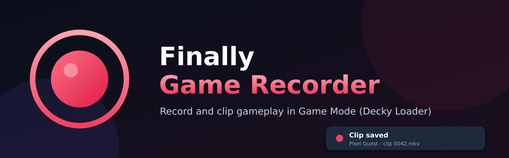
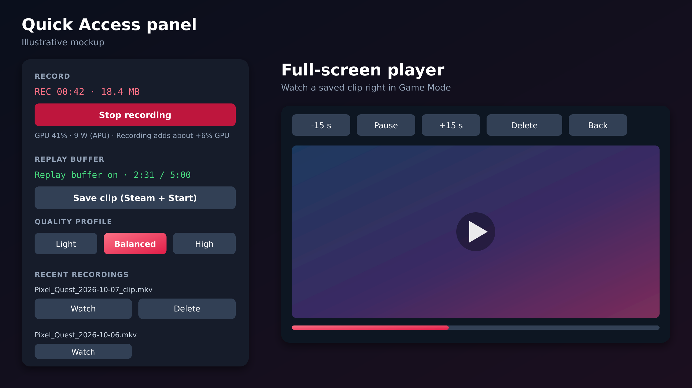

<p align="center">
  
</p>

<p align="center">
  <b>Record gameplay and save clips in Game Mode on Steam Deck, built for Decky Loader.</b><br>
  Manual recording, a RAM replay buffer with a clip shortcut, game audio and microphone.
</p>

<p align="center">
  
  
  
</p>

---

# Finally Game Recorder

Record gameplay in **Game Mode** (Decky Loader): manual recording and a RAM replay buffer with a save-clip shortcut.
Based on decky-recorder-fork (see NOTICE).

## Highlights

- **Record** in mkv or mp4, with the game name in the file name.
- **Replay buffer** that keeps the last 15 s to 10 min in RAM. **Steam + Start** (or the button) saves a clip.
- **Game audio** plus an optional microphone, with echo cancellation and optional rnnoise.
- **Watch clips in Game Mode** with a full-screen player (seek, delete).
- **Light on the game**: one-tap quality profiles, the buffer pauses when no game is running, and quality steps down automatically if the encoder is too slow.
- **Safety**: stops when leaving Game Mode or when the disk is nearly full, recovers unfinished recordings, restarts the buffer after sleep.
- **Diagnostics**: self-test, shortcut status and log, to photograph when something does not work.

<p align="center">
  
</p>

> The image above is an illustrative mockup. A real screenshot from the Steam Deck can replace it in `docs/images/`.

## Install on the Deck

You need Decky Loader installed. Switch to Desktop Mode, open **Konsole** and paste this whole block:

```bash
mkdir -p ~/homebrew/plugins
cd ~/Downloads
rm -f Finally-Game-Recorder.zip
curl -L https://github.com/otisabiburada/finally-game-recorder/releases/latest/download/Finally-Game-Recorder.zip -o Finally-Game-Recorder.zip
sudo rm -rf "$HOME/homebrew/plugins/Finally Game Recorder"
sudo unzip Finally-Game-Recorder.zip -d "$HOME/homebrew/plugins/"
sudo systemctl restart plugin_loader
```

Then go back to Gaming Mode and open the Quick Access menu. You should see **Finally Game Recorder**.
The plugin folder must be exactly `/home/deck/homebrew/plugins/Finally Game Recorder`.
Updating is the same block again. To remove it:

```bash
sudo rm -rf "$HOME/homebrew/plugins/Finally Game Recorder"
sudo systemctl restart plugin_loader
```

## Use
* **Record**: Quick Access menu, mkv or mp4, game name in the file name.
* **Replay buffer**: keeps the last 15 s - 10 min in RAM; **Steam + Start** (or the button) saves a clip.
* Game audio, optional microphone (echo cancellation; rnnoise if `librnnoise_ladspa.so` exists).
* Safety: stops when leaving Game Mode or when the disk is nearly full, restarts the buffer after sleep, recovers
  unfinished recordings, warns when the encoder cannot keep up, shows minutes of space left.
* **Diagnostics**: self-test, shortcut status, log. Photograph it when something does not work.

## How it records
SteamOS' GStreamer captures the screen (`pipewiresrc`) but has no H.264/AAC encoder. `Engine: Auto` therefore uses
GStreamer for capture and the system **ffmpeg** to encode (`h264_vaapi` if it really works, else `libx264`; ffmpeg's
own AAC). If GStreamer *does* have encoders (old Decky Recorder bundle in `bin/` or `backend/out/`), the all-GStreamer
pipeline is used. Freeze check: no new video for N s -> save what exists and continue in a new file.

## Watching a clip
The player has its buttons at the TOP (Steam's hint bar covers the bottom) incl. **Delete** (press twice).
Panel -> **Watch** (under "Last saved" or on any recent file) opens a full-screen player page: buttons Play/Pause, -15 s,
+15 s (L1/R1 also seek), Back (B). Behind it, `finally_playback.py` repackages mkv to mp4 (no re-encode) and serves the file
from a tiny HTTP server on 127.0.0.1 (random token per file, Range support, stops when the plugin unloads).
UNVERIFIED on a real Deck: whether Steam's browser can decode H.264/AAC. If not, the page says so and offers
**Try compatible format** (VP9/Opus WebM, slower, needs `libvpx-vp9` + `libopus` in ffmpeg).

## What recording costs (live)
The panel shows `GPU n% · x W (APU|battery)` read from the kernel (`gpu_busy_percent`, amdgpu hwmon `power1_average`, or the
battery's `power_now`) and, while capturing, "Recording adds about +x% GPU, +y W" = average over the capture vs the 60 s before
it started. Rough: the game's own load may have changed too. Whether these files exist on a Deck is unverified: the self-test
lines "Sensor: GPU load" / "Sensor: power" say so.

## Fast start
The system probe (GStreamer elements, ffmpeg encoders incl. test encodes) is saved to `caps.json` in the settings folder and reused
for up to a week as long as the tool binaries, GPU video drivers and kernel are unchanged (a SteamOS update re-probes).
A failed start deletes it, the self-test always probes fresh, a failed probe is never saved. 5 s after load the plugin probes (or
loads) in the background so the panel opens fast.

## Performance (what it costs the game)
Not measured on a real Deck yet - the panel shows live `CPU n% (100 = one core; the Deck has 8 threads)` and encode speed.
Confirmed on a real Deck: the GPU encoder `h264_vaapi` works and is used (light on CPU). What still costs something: the
screen frames are copied through the CPU (colour conversion + ~90 MB/s at 1280x800@60), and the GPU encoder shares power
and memory bandwidth with the game.
Levers, all in Settings:
* **Quality profile** (one tap): Light = 30 fps, 960x600, 5 Mbps; Balanced = 30 fps full size 8 Mbps; High = 60 fps 12 Mbps.
  Pixel rate drops ~3x from High to Light. Presets are a maximum box that keeps the screen's shape.
* **Replay buffer only while a game runs** (default on): nothing is captured on the Steam home screen.
* **Lower quality automatically if too slow** (default on): encoder under 0.9x real time for 10 s -> 30 fps, then 960x600,
  then 5 Mbps; the recording continues in a new file and a toast says what changed.
* Low CPU priority for the recording processes (default on), libx264 thread limit (software encoding only).
**Zero-copy capture** (`kmsgrab` -> VAAPI) would remove the CPU copies; another Decky plugin reports <3% CPU with it. It is
NOT used here: ffmpeg's docs say it needs root/CAP_SYS_ADMIN, a gamescope issue reports ffmpeg crashing when switching between
the Steam UI and a game (plane format change), and screen rotation (the Deck panel is natively portrait) is unresolved.
Measured on a real Deck: the plugin runs as the normal `deck` user (no CAP_SYS_ADMIN), so kmsgrab cannot run; the self-test now
says so instead of trying. It would need the plugin to run as root (`"flags": ["root"]` in plugin.json) - not recommended.

## Screen capture diagnostics
Seen on a real Deck: `pipewiresrc ! fakesink` failed with only "Failed to set pipeline to PAUSED". The self-test now tries
(1) that plain test, (2) with `videoconvert`, (3) the recorder's exact source chain, with `GST_DEBUG=2,pipewiresrc:4` so the real
reason is shown (also written to the log), lists PipeWire video nodes (`pw-dump`) and says whether a game is running.
Hypothesis (unverified): fakesink lets pipewiresrc pick a DMA-BUF format that fails; the recorder's chain forces plain memory.

## Shortcut
**Seen on a real Deck:** current Steam clients no longer offer `SteamClient.Input.RegisterForControllerStateChanges` (the call
the original plugin used), so the Steam-UI path (`src/shortcuts.ts`) is dormant there and shown as "not offered (normal)".
Shortcuts work through the backend reader (`finally_hotkeys.py`) that watches the Deck controller's HID node
(USB 28de:1205) and tells the frontend (`src/actions.ts: trigger`, 2 s cooldown). On the Deck its reports arrived with
header `01 00 09` as expected. Still to confirm by pressing buttons: Steam 0x2000, Menu 0x4000, View 0x1000 must show up in
Diagnostics `last 0x...`, and `fired` must increase on Steam + Start.

## Building from source
The built frontend (`dist/`) is what Decky loads. Releases are built by GitHub Actions (`.github/workflows/release.yml`) when you push a tag such as `v1.12.0`, and the zip is attached to the release. To build it yourself:
```
pnpm install && pnpm run build           # frontend -> dist/   (needed whenever src/ changed)
sudo cp -r . ~/homebrew/plugins/"Finally Game Recorder" && sudo systemctl restart plugin_loader
```
Backend-only change (any `*.py`): `sudo cp *.py ~/homebrew/plugins/"Finally Game Recorder"/ && sudo systemctl restart plugin_loader`

## For developers
`python3 tests/run.py map` lists every source file with its size and purpose (~40 lines), so you do not need to open them all.

| Task | Open | Check with |
|---|---|---|
| settings, names, argv building, monitors | `core_base.py` / `core_gst.py` / `core_ffmpeg.py` | `run.py quick` |
| start/stop of capture processes | `finally_capture.py` (+ `finally_caps.py` for probing) | `run.py area record` + `area ffmpeg` |
| shortcuts (Steam+Start), controller reader | `finally_hotkeys.py` (+ `src/shortcuts.ts`, `src/actions.ts`) | `run.py area hotkeys` |
| pause buffer without a game, auto step-down | `finally_adapt.py` (+ `src/profiles.ts`) | `run.py area adapt` |
| GPU/power readout, 'recording costs' | `finally_sensors.py`, `core_system.py` | `run.py area system` |
| saved capability probe (fast start) | `finally_caps.py`, `core_system.py` | `run.py area system` |
| watching a clip in the Steam UI | `finally_playback.py` + `src/panel/Player.tsx`, `src/player.ts` | `run.py area playback` |
| freeze / crash / sleep handling | `finally_watchdog.py` | `run.py area watchdog` |
| replay clips, recordings list | `finally_files.py` | `run.py area replay` |
| audio sink / microphone | `finally_audio.py` | `run.py area record` |
| self-test | `finally_diag.py` | `run.py area misc` |
| new backend method for the UI | `main.py` + `src/api.ts` | `run.py quick` (API-surface test) |
| a panel section | `src/panel/<Section>.tsx` | `run.py quick` (tsc) |

**Checks - cheap first, expensive last** (all output is tiny by design):
```
python3 tests/run.py quick        # ~2 s: lint + unit/regression/API tests + TypeScript check.  After EVERY edit.
python3 tests/run.py area NAME    # record | replay | ffmpeg | watchdog | misc | hotkeys | playback | adapt | system  (6-110 s each). When you touched that area.
python3 tests/run.py full         # everything, in the BACKGROUND (~5 min, one CPU core). Before packaging only.
python3 tests/run.py status       # one line; failures only
```
Rules that avoid hangs: never run the old monolithic suite in the foreground; never `pkill -f` with a pattern that is
in your own command line (it kills your shell) - use `run.py stop`; run only one `full` at a time (areas share
ffmpeg/CPU and timing-sensitive tests).
Backend tests use a FAKE `gst-launch`/`pactl` plus REAL ffmpeg: they prove control flow, not GPU/PipeWire behaviour.
`tsc` uses hand-written stubs (`typecheck/stubs.d.ts`): `@decky/api` ones match the published types, `@decky/ui` and
`react` are from memory - `pnpm run build` stays the final judge.
Size guard: a test fails if any source file exceeds 18 KB - split by responsibility instead.

## License

BSD 3-Clause, see [LICENSE](LICENSE) and [NOTICE](NOTICE).
